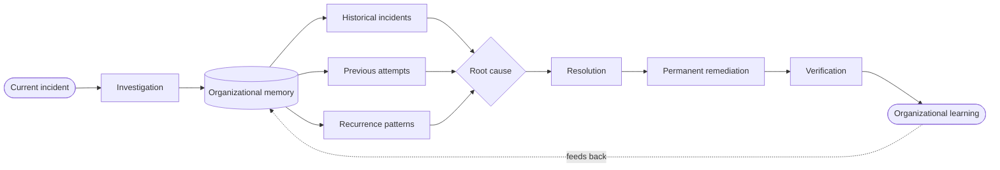
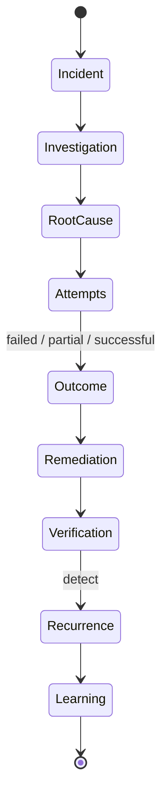
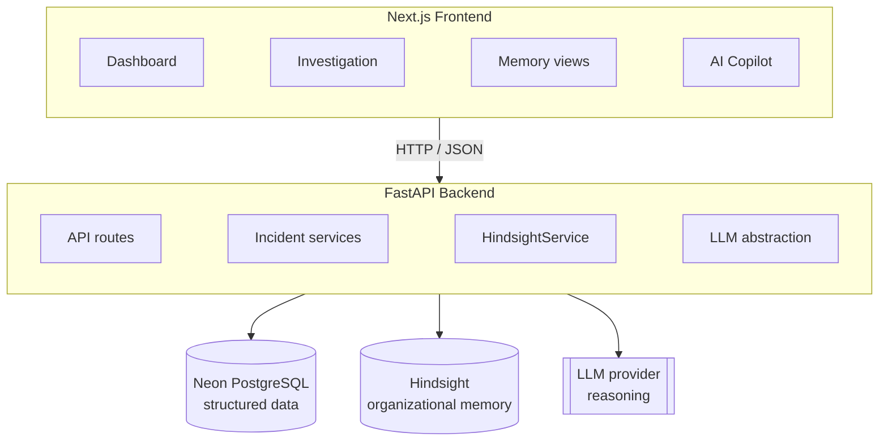
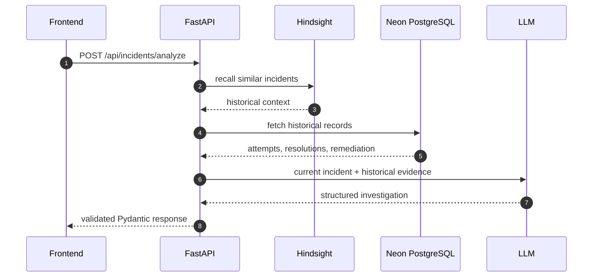
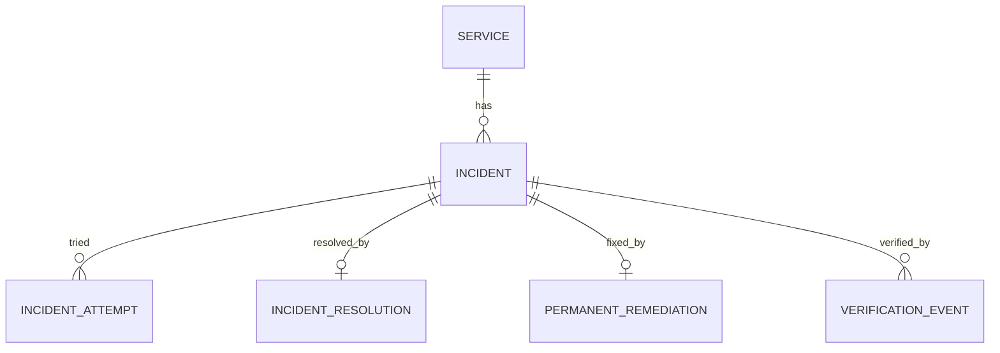
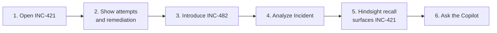

<div align="center">


<a href="https://git.io/typing-svg">
  
</a>

<br/>


<br/>

> **Don't just remember how we fixed the incident.**
> **Remember whether we actually fixed the problem.**

[Overview](#-overview) · [How it works](#-how-it-works) · [Features](#-key-capabilities) · [Architecture](#-architecture) · [Quick start](#-quick-start) · [Demo](#-demo-walkthrough) · [Roadmap](#-roadmap)

</div>

---

## 🎯 Overview

**RESOLVE** is an AI-powered incident intelligence platform that turns incident response from a pile of isolated tickets into a continuously improving **organizational memory**.

Instead of treating every incident as brand new, RESOLVE connects the current incident with past investigations, root causes, attempted fixes, successful resolutions, permanent remediation, verification evidence, and recurrence patterns.

<div align="center">


</div>

<br/>

<table>
  <tr>
    <td width="33%" valign="top">
      <h3>🧠 Memory</h3>
      <a href="https://hindsight.vectorize.io">Hindsight</a> retains what the organization learned and recalls it when a similar incident appears.
    </td>
    <td width="33%" valign="top">
      <h3>🗄️ Structured truth</h3>
      Neon PostgreSQL stores incidents, attempts, resolutions, remediation, and verification events.
    </td>
    <td width="33%" valign="top">
      <h3>🤖 Reasoning</h3>
      A configurable LLM layer reasons over current symptoms plus recovered history.
    </td>
  </tr>
</table>

---

## 😩 The Problem

Incident tools are good at recording *what happened*. The harder part is keeping *what the organization learned*.

That knowledge ends up scattered across tickets, docs, dashboards, and people. When a similar incident returns months later, engineers often rebuild the investigation from scratch.

RESOLVE is built on one principle:

```text
Every incident should contribute to organizational memory.
```

---

## 🔁 How It Works

A worked example from the RESOLVE demo dataset:

<table>
  <tr>
    <td width="50%" valign="top">
      <h3>📁 INC-421 · historical</h3>
      <b>Service:</b> Payment Service<br/>
      <b>Root cause:</b> Database connection pool exhaustion<br/><br/>
      <b>Attempts</b><br/>
      🔴 Restart → <code>FAILED</code><br/>
      🟡 Timeout increase → <code>PARTIAL</code><br/>
      🟢 Connection configuration correction → <code>SUCCESSFUL</code><br/><br/>
      <b>Permanent remediation:</b> configuration correction + monitoring<br/>
      <b>Verification:</b> healthy on Day 1, 30, 90, 147
    </td>
    <td width="50%" valign="top">
      <h3>🚨 INC-482 · new</h3>
      <b>Service:</b> Payment Service<br/>
      <b>Symptoms:</b> 503 errors, connection failures<br/><br/>
      <b>RESOLVE asks</b><br/>
      • Have we seen this before?<br/>
      • What happened last time?<br/>
      • What did we try, and what failed?<br/>
      • Was the previous remediation effective?<br/>
      • Did the problem recur?
    </td>
  </tr>
</table>



---

## ✨ Key Capabilities

<table>
  <tr>
    <td width="33%" valign="top">
      <h3>🔎 Incident Intelligence</h3>
      Track service, severity, symptoms, investigation state, root-cause hypotheses, and resolution history together.
    </td>
    <td width="33%" valign="top">
      <h3>🕰️ Historical Recall</h3>
      Query memory for similar incidents, past root causes, attempts, outcomes, and remediation.
    </td>
    <td width="33%" valign="top">
      <h3>⚖️ Attempt Outcomes</h3>
      Distinguish <code>FAILED</code>, <code>PARTIAL</code>, and <code>SUCCESSFUL</code> fixes so history isn't treated as equally effective.
    </td>
  </tr>
  <tr>
    <td width="33%" valign="top">
      <h3>🛠️ Permanent Remediation</h3>
      Separate "the incident is no longer active" from "the underlying problem was addressed."
    </td>
    <td width="33%" valign="top">
      <h3>✅ Verification Memory</h3>
      Keep post-remediation health checks as evidence of whether a fix held over time.
    </td>
    <td width="33%" valign="top">
      <h3>🔗 Recurrence Intelligence</h3>
      Link incidents by service, symptoms, root cause, and remediation to reveal repeating failure patterns.
    </td>
  </tr>
  <tr>
    <td width="33%" valign="top">
      <h3>💬 Contextual Copilot</h3>
      Ask "What worked last time?" and get answers grounded in the current incident plus organizational memory.
    </td>
    <td width="33%" valign="top">
      <h3>🛡️ Honest Degradation</h3>
      If a dependency is down, the UI says so instead of fabricating memory or analysis.
    </td>
    <td width="33%" valign="top">
      <h3>🔐 Backend-only Secrets</h3>
      The browser never talks to PostgreSQL, Hindsight, or the LLM provider directly.
    </td>
  </tr>
</table>

### Incident lifecycle



---

## 🏗️ Architecture



<table>
  <tr>
    <td width="50%" valign="top">
      <h3>🗄️ PostgreSQL = structured operational truth</h3>
      Service, Incident, Incident Attempt, Incident Resolution, Permanent Remediation, Verification Event. Deterministic and queryable.
    </td>
    <td width="50%" valign="top">
      <h3>🧠 Hindsight = persistent organizational memory</h3>
      Incident context, root causes, attempted fixes, outcomes, remediation, verification history, recurrence patterns, lessons learned.
    </td>
  </tr>
</table>

### Analysis pipeline



### Hindsight integration

Hindsight is a core dependency, not a decoration. All access is wrapped in a dedicated service so routes stay SDK-agnostic.

```text
HindsightService
├── retain_incident()
├── recall_similar_incidents()
├── recall_resolution_history()
├── recall_remediation_history()
└── recall_recurrence_patterns()
```

> 📌 **Placeholder:** add a short terminal/code capture showing a real `RETAIN` and `RECALL` call here.

---

## 🧰 Tech Stack

<table>
  <tr>
    <td width="25%" valign="top" align="center">
      <h3>🖥️ Frontend</h3>
      Next.js<br/>React<br/>TypeScript<br/>Tailwind CSS
    </td>
    <td width="25%" valign="top" align="center">
      <h3>⚙️ Backend</h3>
      Python<br/>FastAPI<br/>Pydantic<br/>pytest
    </td>
    <td width="25%" valign="top" align="center">
      <h3>🗄️ Data</h3>
      Neon PostgreSQL<br/>SQLAlchemy Async<br/>asyncpg<br/>Alembic
    </td>
    <td width="25%" valign="top" align="center">
      <h3>🧠 AI &amp; Memory</h3>
      Hindsight<br/><code>hindsight-client</code><br/>Configurable LLM
    </td>
  </tr>
</table>

---

## 🔌 API

| Method | Endpoint | Purpose |
| :----: | :------- | :------ |
| `GET` | `/api/incidents` | List incidents |
| `GET` | `/api/incidents/{id}` | Get one incident |
| `POST` | `/api/incidents/analyze` | Analyze an incident using historical context |
| `GET` | `/api/incidents/{id}/memory` | Incident memory |
| `GET` | `/api/incidents/{id}/resolution` | Resolution history |
| `GET` | `/api/incidents/{id}/remediation` | Remediation information |
| `GET` | `/api/patterns` | Recurrence patterns |
| `GET` | `/api/services` | Service information |

Responses use stable Pydantic schemas. Interactive docs are served at `/docs` (Swagger).

### Data model



---

## 🖼️ Screens

> 📸 **Placeholders:** add screenshots or a demo GIF for each view below (for example under `docs/screenshots/`).

<table>
  <tr>
    <td width="33%" align="center"><b>Dashboard</b><br/><sub>operational overview</sub><br/><br/><i>[screenshot placeholder]</i></td>
    <td width="33%" align="center"><b>Incident Investigation</b><br/><sub>INC-482 view</sub><br/><br/><i>[screenshot placeholder]</i></td>
    <td width="33%" align="center"><b>Hindsight Memory</b><br/><sub>recalled context</sub><br/><br/><i>[screenshot placeholder]</i></td>
  </tr>
  <tr>
    <td width="33%" align="center"><b>Resolution Memory</b><br/><sub>attempts and outcomes</sub><br/><br/><i>[screenshot placeholder]</i></td>
    <td width="33%" align="center"><b>Remediation Memory</b><br/><sub>fixes and verification</sub><br/><br/><i>[screenshot placeholder]</i></td>
    <td width="33%" align="center"><b>AI Copilot</b><br/><sub>contextual answers</sub><br/><br/><i>[screenshot placeholder]</i></td>
  </tr>
</table>

Also part of the interface: **Active Incidents**, **Recurrence Patterns**, and **Services**.

---

## 🚀 Quick Start

**Prerequisites:** Node.js + npm, Python, a Neon PostgreSQL project, Hindsight API credentials, and LLM provider credentials.

```bash
# 1. Clone
git clone <your-repository-url>
cd resolve

# 2. Frontend deps
npm install

# 3. Backend env
cd backend
python -m venv .venv
source .venv/bin/activate        # Windows: .venv\Scripts\activate
pip install -r requirements.txt
```

<details>
<summary><b>🔑 Environment variables</b></summary>

<br/>

Copy `.env.example` and fill in your values. **Never commit real credentials.**

```env
DATABASE_URL=

HINDSIGHT_API_URL=
HINDSIGHT_API_KEY=
HINDSIGHT_BANK_ID=

LLM_PROVIDER=
LLM_MODEL=
LLM_API_KEY=

NEXT_PUBLIC_API_URL=http://localhost:8000
```

`DATABASE_URL`, `HINDSIGHT_API_KEY`, and `LLM_API_KEY` must stay backend-only. Recommended `.gitignore` entries: `.env`, `.env.local`, `.env.*.local`.

</details>

```bash
# 4. Migrate the database (from /backend)
alembic upgrade head

# 5. Run the backend  →  http://localhost:8000  (docs at /docs)
uvicorn main:app --reload --port 8000

# 6. Run the frontend (from project root)  →  http://localhost:3000
npm run dev
```

<details>
<summary><b>📂 Project structure</b></summary>

<br/>

```text
resolve/
├── src/                          # Next.js frontend
│   ├── app/
│   ├── components/
│   ├── lib/
│   └── types/
├── backend/
│   ├── app/
│   │   ├── api/                  # incidents, memory, patterns, services
│   │   ├── core/                 # config, database
│   │   ├── models/               # incident, attempt, resolution, remediation,
│   │   │                         # service, verification_event
│   │   ├── schemas/
│   │   └── services/             # hindsight_service, incident_service
│   ├── alembic/
│   ├── tests/
│   ├── main.py
│   └── requirements.txt
├── assets/                       # README visuals
├── .env.example
├── package.json
└── README.md
```

</details>

---

## 🎬 Demo Walkthrough



Copilot prompts to try, in order:

1. *Have we seen this before?*
2. *What failed previously?*
3. *What worked last time?*

> 🎥 **Placeholder:** add demo video / live demo link here.

---

## 🧪 Testing & Validation

<table>
  <tr>
    <td width="33%" valign="top">
      <h3>Frontend</h3>

```bash
npm run lint
npx tsc --noEmit
npm run build
```
    </td>
    <td width="33%" valign="top">
      <h3>Backend</h3>

```bash
cd backend
pytest
alembic upgrade head
```
    </td>
    <td width="33%" valign="top">
      <h3>Integrations</h3>
      Verify real Hindsight <code>RETAIN</code> and <code>RECALL</code>, and a real LLM round trip. No simulated responses.
    </td>
  </tr>
</table>

Fill this in from commands you actually ran:

- [ ] Frontend lint
- [ ] TypeScript check
- [ ] Production build
- [ ] Backend tests
- [ ] Database connection and Alembic migrations
- [ ] Hindsight retain
- [ ] Hindsight recall
- [ ] LLM request
- [ ] INC-482 end-to-end flow

---

## 🛡️ Failure Handling & Security

<table>
  <tr>
    <td width="33%" valign="top">
      <h3>🗄️ Database down</h3>
      Backend returns a clear database-related error.
    </td>
    <td width="33%" valign="top">
      <h3>🧠 Hindsight down</h3>
      UI shows a degraded-memory state: <i>"Historical recall could not be completed."</i> It never claims memory was retrieved when it wasn't.
    </td>
    <td width="33%" valign="top">
      <h3>🤖 LLM down</h3>
      Historical evidence stays available; no AI answer is fabricated.
    </td>
  </tr>
</table>

- API, database, Hindsight, and LLM credentials stay server-side and come from environment variables.
- The frontend never connects to PostgreSQL, Hindsight, or the LLM provider.
- Secrets are never committed; `.env.example` holds placeholders only.

---

## 🗺️ Roadmap

<table>
  <tr>
    <td width="33%" valign="top"><h3>📈 Remediation Effectiveness</h3>Track whether fixes hold across longer periods.</td>
    <td width="33%" valign="top"><h3>🔁 Advanced Recurrence</h3>Find failure patterns across services and incidents.</td>
    <td width="33%" valign="top"><h3>🕸️ Memory Graph</h3>Link incidents, services, root causes, attempts, and remediation.</td>
  </tr>
  <tr>
    <td width="33%" valign="top"><h3>🧾 Evidence Trace</h3>Show the retrieved Hindsight context during an investigation.</td>
    <td width="33%" valign="top"><h3>⏳ Learning Timeline</h3>Visualize how organizational knowledge evolved.</td>
    <td width="33%" valign="top"><h3>🚧 Recommendation Guardrails</h3>Separate proven fixes from repeatedly failed ones.</td>
  </tr>
</table>

---

## 💡 Design Philosophy

> **An incident should not end when the alert disappears.**

It ends when the problem is understood, the right remediation is applied and verified, the learning is preserved, and the organization can use it again.

---

## 👥 Team

> **Placeholder:** add team member names, roles, and profile links.

## 🤝 Contributing

1. Understand the existing architecture and keep the frontend/backend separation.
2. Keep Hindsight access behind `HindsightService` and LLM credentials server-side.
3. Maintain stable API contracts and add tests for significant backend changes.
4. Run lint, type check, build, and tests before opening a PR.

## 📄 License

> **Placeholder:** add your license (for example MIT) and a `LICENSE` file, or follow your hackathon repository's requirements.

<div align="center">

<br/>

**RESOLVE** · *Incident response that remembers.*


</div>"# ResolveAi" 
